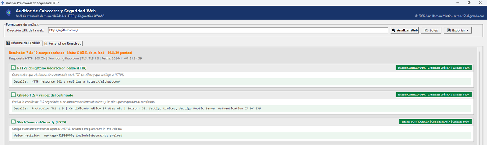

# Auditor de Seguridad Web

Auditor de seguridad HTTP para Windows con dos implementaciones independientes:
una **interfaz Python (Tkinter)** sobre un núcleo nativo, y una **aplicación
nativa C++ (Win32)**. Ambas analizan las cabeceras de seguridad, el transporte
TLS, las cookies y CORS, calculan una nota y generan informes en **PDF, JSON y
CSV**.

Copyright (c) 2026 Juan Ramon Martin — <zeronet75@gmail.com>

[](LICENSE)



## Características

- **13 comprobaciones** por auditoría:
  - HTTPS obligatorio (sonda real al puerto 80 y redirección a HTTPS)
  - Cifrado TLS y validez del certificado (versión negociada, TLS 1.0/1.1, días restantes, emisor)
  - HSTS, CSP, X-Frame-Options, X-Content-Type-Options, Referrer-Policy,
    Permissions-Policy, COOP, COEP (informativa) y Cache-Control (informativa)
  - Cookies (`Secure` / `HttpOnly` / `SameSite`)
  - CORS (`Access-Control-Allow-Origin` con comodín y credenciales)
- **Nota por peso y calidad**: no basta con que la cabecera exista; un valor
  débil (`unsafe-inline`, `max-age=0`, `ALLOWALL`, cookies sin `Secure`…) resta
  puntos y se muestra como **DÉBIL** con su porcentaje de calidad.
- **Diagnóstico real de errores**: DNS, timeout, certificado caducado o de otro
  dominio, CA desconocida, bucles de redirección, HTTP 404/403…
- **Historial** con copia de seguridad automática (`*.bak.json`) y restauración.
- **Auditoría por lotes** desde un archivo de texto.
- **Exportación** a PDF (con copyright y numeración), JSON y CSV (UTF-8).
- **Modo consola** en la versión nativa para automatizar:
  `auditor.exe --json <url>` y `auditor.exe --pdf <url> <salida.pdf>`.

## Idiomas

La interfaz y los informes están disponibles en **16 idiomas** con un archivo
JSON por idioma en `localizations/`:

`en_US` (base), `ar_AR`, `de_DE`, `es_ES`, `fr_FR`, `hi_IN`, `id_ID`, `it_IT`,
`ja_JP`, `ko_KR`, `pt_BR`, `ru_RU`, `tr_TR`, `vi_VN`, `zh_CN` y `zh_TW`.

- Menú **Idioma / Language** con el nombre nativo y marca de verificación.
- Cambio **en caliente** (sin reiniciar) en las dos versiones.
- La elección se guarda en `%APPDATA%\AuditorSeguridadWeb\settings.json`.
- Fallback: idioma actual → inglés → clave.
- Para añadir un idioma basta con copiar un JSON de `localizations/` y cambiar
  el código y el nombre nativo. Instrucciones en
  [`localizations/README.md`](python/localizations/README.md).

## Estructura

```
python/   Interfaz Tkinter + núcleo C++ (auditor_core.exe)
cpp/      Aplicación nativa Win32 completa (un solo .exe)
docs/     Capturas para la documentación
```

## Requisitos

| | |
|---|---|
| Sistema | Windows 10/11 (x64) |
| Python | 3.10 o superior (probado con 3.15) |
| Librerías Python | `reportlab`, `pyinstaller` |
| Compilador | Visual Studio con herramientas de C++ (MSVC + Windows SDK) |
| PDF nativo | Impresora virtual «Microsoft Print to PDF» (incluida en Windows) |

## Compilación

### Versión Python

```powershell
cd python

# 1) Núcleo nativo (WinHTTP)
rc /nologo /fo auditor_core.res auditor_core.rc
cl /O2 /EHsc /utf-8 auditor_core.cpp auditor_core.res /link /SUBSYSTEM:CONSOLE winhttp.lib

# 2) Interfaz (un solo .exe, sin consola, con icono y versión)
py -m PyInstaller --noconfirm --onefile --noconsole --icon escudo.ico --version-file version_info.txt auditor.py
```

Distribución: `auditor.exe` + `auditor_core.exe` + `escudo.ico` en la misma carpeta.

### Versión C++ nativa

```powershell
cd cpp
rc /nologo /fo auditor.res auditor.rc
cl /O2 /EHsc /utf-8 /std:c++17 auditor.cpp auditor.res /link /SUBSYSTEM:WINDOWS user32.lib gdi32.lib comctl32.lib winhttp.lib comdlg32.lib shell32.lib
```

## Uso

1. Escribe la dirección (por ejemplo `ejemplo.com`) y pulsa **Analizar Web**.
2. Cada tarjeta muestra el estado, la criticidad y la calidad del valor, además
   de una observación cuando la configuración es mejorable.
3. **Exportar** genera el informe en PDF, JSON o CSV.
4. La pestaña **Historial** guarda hasta 30 auditorías; doble clic para verlas y
   **Restaurar Copia** recupera registros de la copia de seguridad.

### Modo consola (solo versión nativa)

```powershell
auditor.exe --json https://ejemplo.com
auditor.exe --pdf  https://ejemplo.com informe.pdf
```

No abre ventana y devuelve el código 0 si el análisis fue correcto, o 2 si hubo
un error controlado (el JSON incluye el motivo en `mensaje`).

## Cómo se calcula la nota

`nota = Σ(peso × calidad) / Σ(peso)`, con `calidad = 100 − penalización`.

| Comprobación | Peso | Penalización máxima |
|---|---|---|
| HTTPS obligatorio | 4 | 100 (HTTP sin redirección) |
| TLS y certificado | 4 | 80 (certificado a punto de caducar) |
| Content-Security-Policy | 4 | 40 |
| HSTS | 3 | 70 |
| Permissions-Policy | 3 | 40 |
| Cookies seguras | 3 | 60 |
| X-Frame-Options | 2 | 70 |
| X-Content-Type-Options | 2 | 60 |
| Referrer-Policy | 2 | 50 |
| COOP | 2 | 40 |
| CORS | 2 | 90 |
| COEP / Cache-Control | 0 | informativas (no puntúan) |

Escala: **A+** ≥ 95 %, **A** ≥ 85 %, **B** ≥ 70 %, **C** ≥ 50 %, **D** ≥ 30 %, **F** < 30 %.

## Pruebas

```powershell
cd python ; python tests_auditor.py --online
cd cpp    ; python tests_auditor_nativo.py
```

Las pruebas levantan un servidor HTTP propio en un puerto libre y verifican
redirecciones relativas, bucles, 404, cookies, CORS, puntuación y exportaciones,
sin depender de Internet (salvo con `--online`).

## Descargas

Los ejecutables listos para usar se publican en
[**Releases**](https://github.com/zeronet75/auditor-seguridad-web/releases):

- `auditor-seguridad-web-python-*.zip`: interfaz Python (`auditor.exe` + `auditor_core.exe`).
- `auditor-seguridad-web-nativo-*.zip`: aplicación nativa (`auditor.exe`).

Descomprime el ZIP completo en una carpeta y ejecuta `auditor.exe`. Windows puede
mostrar el aviso de SmartScreen porque los binarios no están firmados: elige
«Más información → Ejecutar de todas formas».

## Privacidad

El historial (`historial_auditorias.json`), las copias `.bak.json`, los
ejecutables y los informes generados **no** se incluyen en el repositorio: están
en `.gitignore`. Las auditorías se ejecutan desde tu equipo; el programa solo
realiza peticiones HTTP/HTTPS al sitio indicado.

## Licencia

[MIT](LICENSE) © 2026 Juan Ramon Martin. Puedes usar, modificar y redistribuir
el código, incluso comercialmente, conservando el aviso de copyright.
